<div align="center">

# Abhishek Rai A

**Aspiring Machine Learning Engineer**<br>
B.E. in AI & ML, Mysore University · Mysuru, India

[](https://portfolio.abhirai2006.workers.dev/)
&nbsp;


[**Live site**](https://portfolio.abhirai2006.workers.dev/) ·
[Projects](https://portfolio.abhirai2006.workers.dev/#projects) ·
[Anime shelf](https://portfolio.abhirai2006.workers.dev/anime) ·
[Résumé](https://portfolio.abhirai2006.workers.dev/resume) ·
[Reviews](https://portfolio.abhirai2006.workers.dev/reviews)

<br>

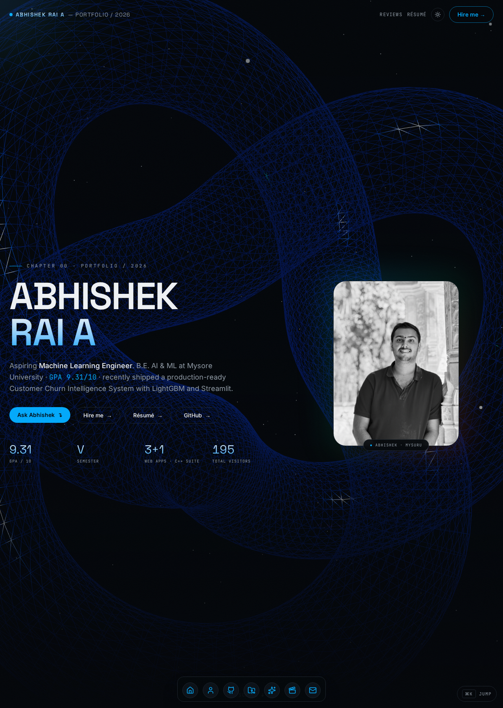

</div>

<br>

## Contents

[Overview](#overview) · [Highlights](#highlights) · [Preview](#preview) · [Projects](#projects) · [How it fits together](#how-it-fits-together) · [What it runs on](#what-it-runs-on) · [Getting started](#getting-started) · [Database](#database) · [Deploying](#deploying) · [Scripts](#scripts) · [Project structure](#project-structure) · [Security](#security) · [Contact](#contact)

## Overview

This is my personal portfolio. It shows the projects I have built, my résumé and my GitHub activity, and it has a small assistant that answers questions about my background so a recruiter does not have to dig through links. There is also a side page with every anime I have finished, because it is a big part of how I spend my free time.

I wrote the ML and algorithm projects myself. The web side of this site was built with AI tools as a copilot, so I list its stack below as what the code uses, not as skills I am claiming.

## Highlights

| | |
| --- | --- |
| **Projects on a ring** | The Arsenal is a slowly turning 3D ring of project cards. Drag it, flick it, use the arrows or the keyboard, and click a card to open it. It respects reduced motion. |
| **Screenshots that follow your theme** | Each project pop-up shows a dark or light screenshot to match the theme the visitor is using, and swaps when they flip the toggle. |
| **Ask Abhishek** | A chat assistant that only knows my résumé and projects. It streams replies from the server, retries once if the model is busy, then falls back to a lighter model. |
| **Live GitHub activity** | Recent repositories and a contribution heatmap, pulled from the GitHub API and cached for 10 minutes. |
| **Anime shelf** | A scroll-driven 3D shelf of 60 titles at `/anime`, with mood-based picks, random discovery, a watch breakdown and recommendations from visitors. |
| **Reviews and résumé** | Visitors can leave a review at `/reviews`. The résumé at `/resume` is a clean page that prints well. |
| **Jump anywhere** | Press `Cmd/Ctrl + K` to open a command palette for chapters, case studies and contact options. |
| **Careful with data** | Anonymous page events only, no personal data. Visitors can add reviews and recommendations but cannot edit or delete anything. |

## Preview

<table>
  <tr>
    <td align="center">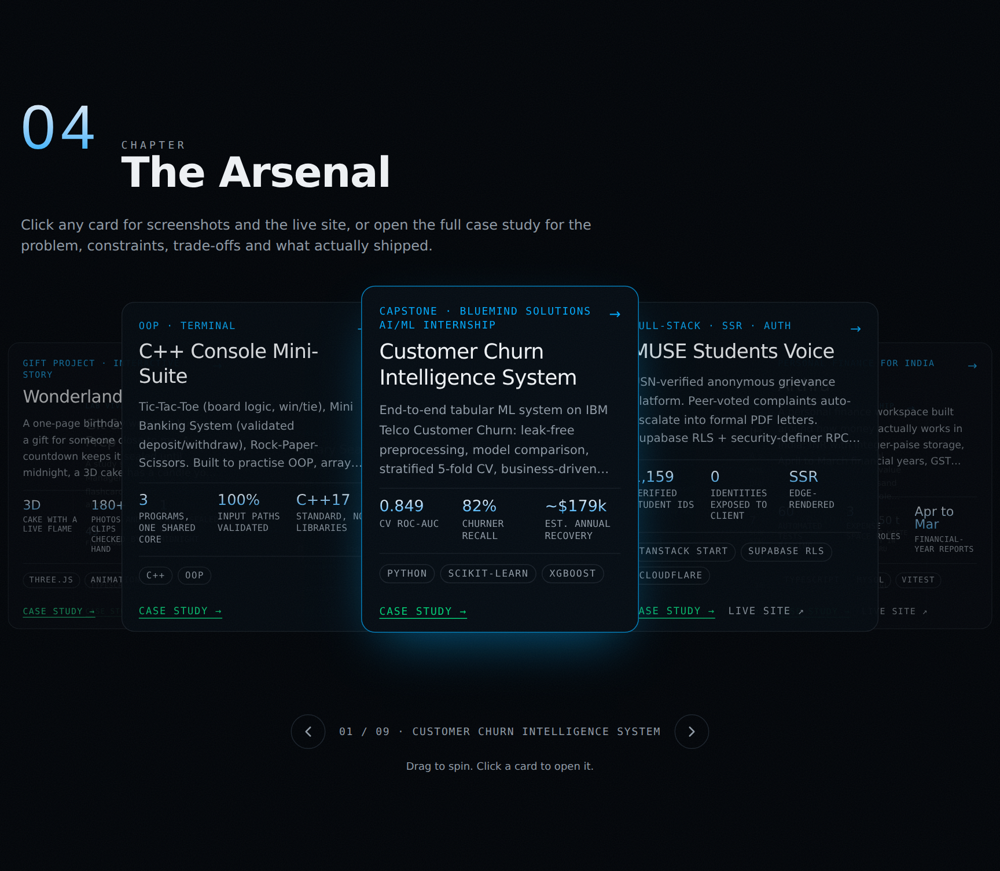<br><sub>The Arsenal: projects on a ring you can spin</sub></td>
    <td align="center">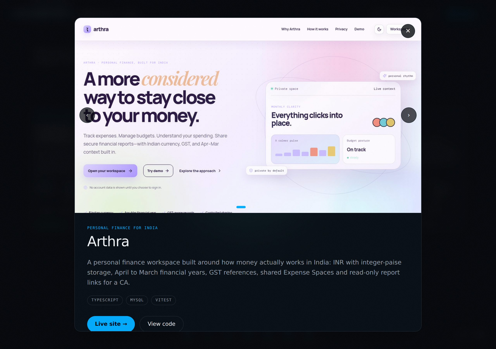<br><sub>Click a card to open it</sub></td>
  </tr>
  <tr>
    <td align="center">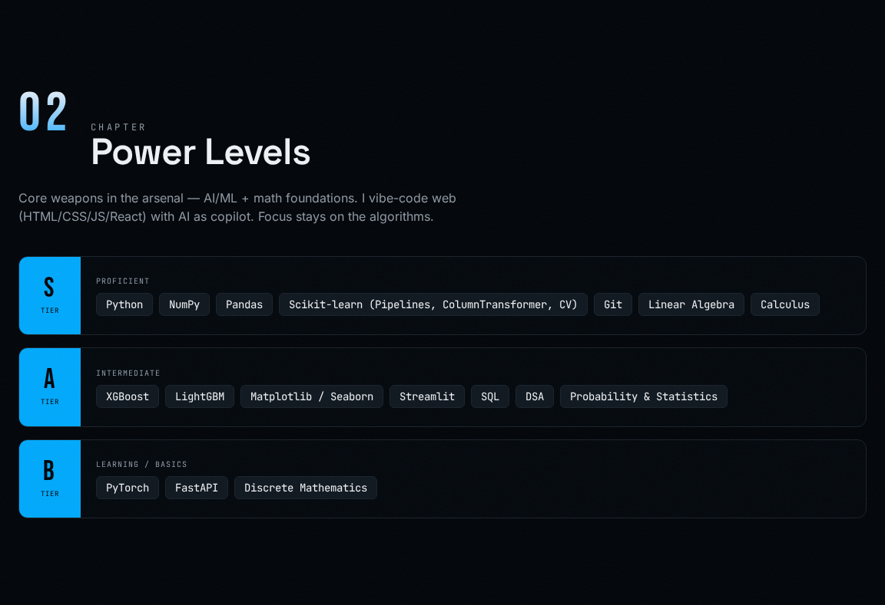<br><sub>Skills and how well I know them</sub></td>
    <td align="center">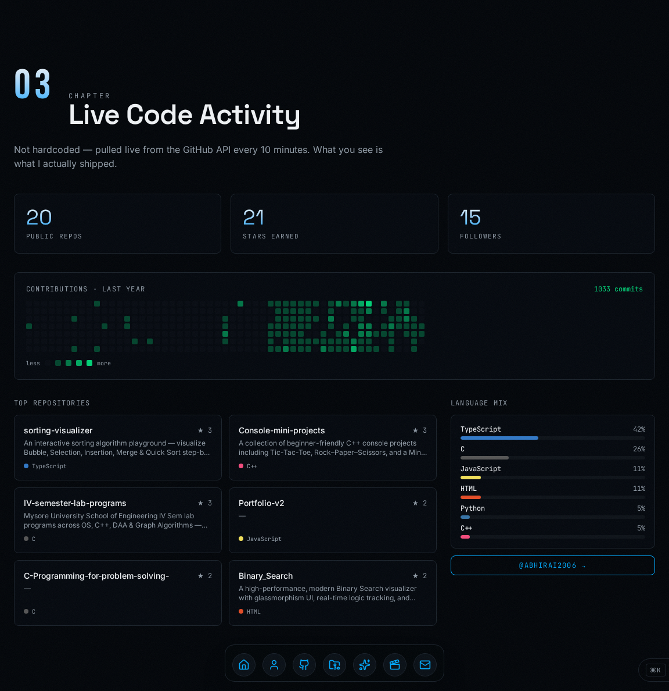<br><sub>Live GitHub activity</sub></td>
  </tr>
  <tr>
    <td align="center">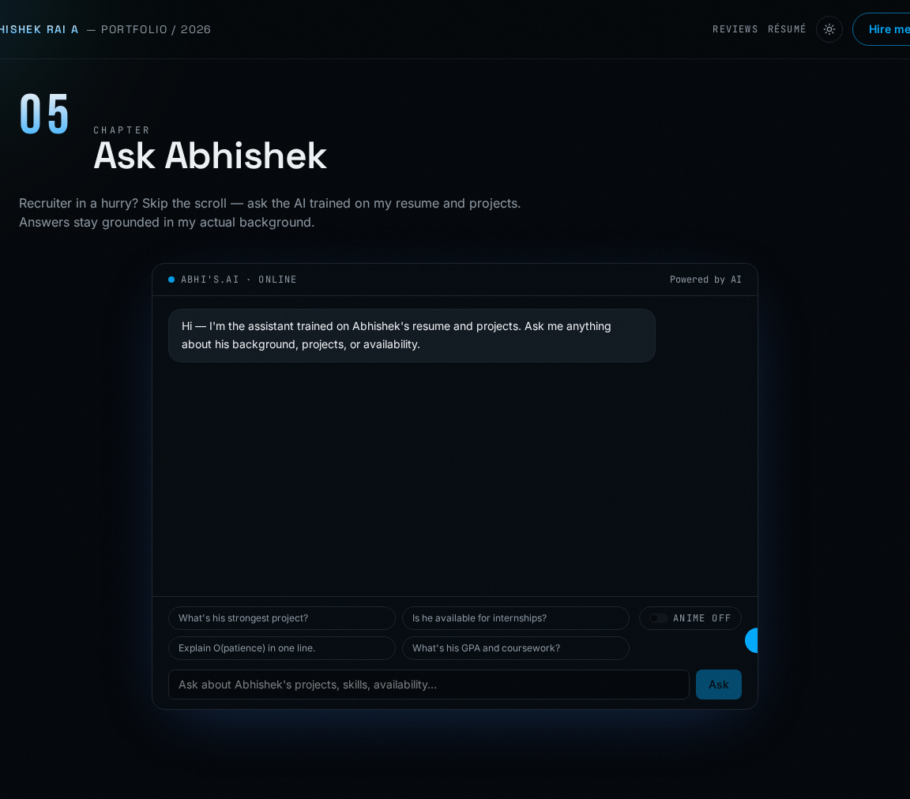<br><sub>Ask Abhishek, the résumé-only assistant</sub></td>
    <td align="center">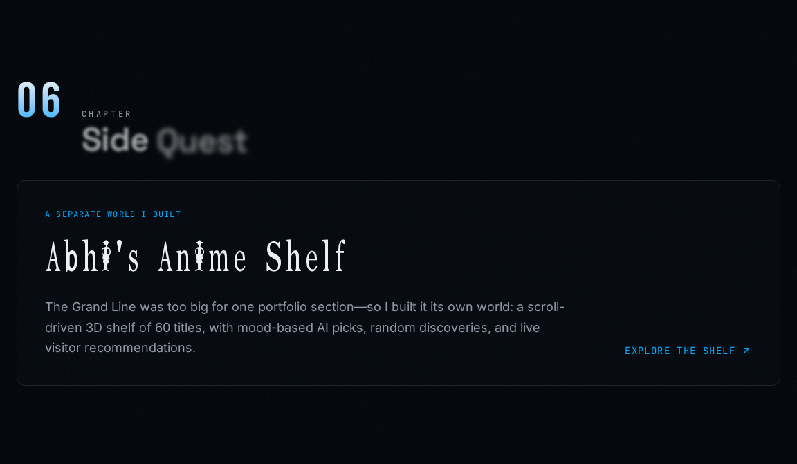<br><sub>The way into the anime shelf</sub></td>
  </tr>
  <tr>
    <td align="center">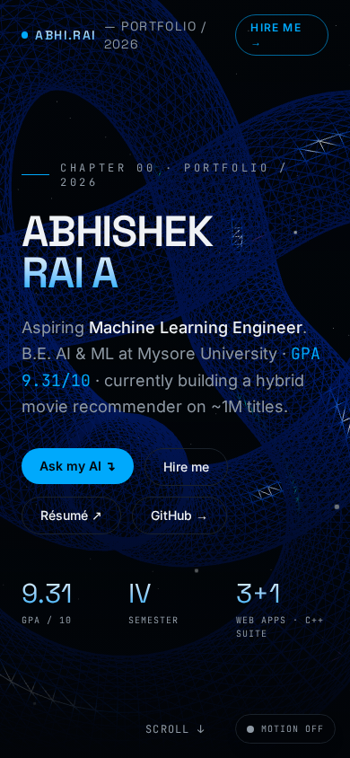<br><sub>On a phone</sub></td>
    <td align="center">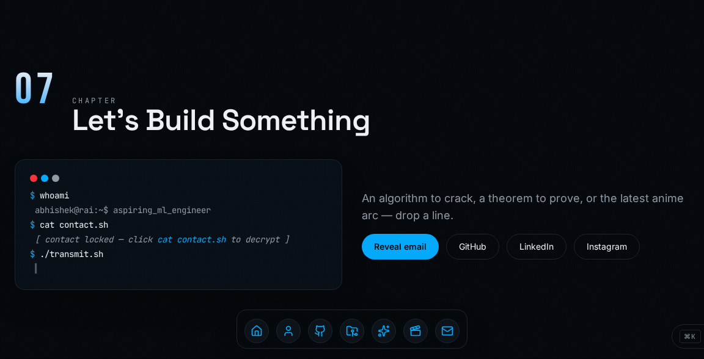<br><sub>Contact</sub></td>
  </tr>
</table>

## Projects

Every project has a full case study on the site: the problem, the constraints, what was built, the trade-offs and the outcome.

| Project | What it is | Links |
| --- | --- | --- |
| **Customer Churn Intelligence System** | Capstone of my Bluemind Solutions AI/ML internship. An end-to-end tabular ML system on the IBM Telco churn data with leak-free preprocessing, model comparison and stratified 5-fold cross-validation. ROC-AUC 0.849, 82% churner recall. | [Case study](https://portfolio.abhirai2006.workers.dev/projects/customer-churn-intelligence-system) |
| **MUSE Students Voice** | A USN-verified anonymous grievance platform. Peer-voted complaints escalate automatically into formal PDF letters. | [Live](https://muse-studentsvoice.lovable.app/) · [Case study](https://portfolio.abhirai2006.workers.dev/projects/muse-students-voice) |
| **Arthra** | Personal finance for India: INR stored as integer paise, April to March financial years, shared Expense Spaces and read-only report links. 60 automated tests. | [Live](https://arthrafin-7qakibfj.manus.space) · [Code](https://github.com/Abhirai2006/arthra) · [Case study](https://portfolio.abhirai2006.workers.dev/projects/arthra) |
| **Ittige** | A scroll-driven site for our team's plastic-to-paver business plan in Mysuru, with honest cost numbers. | [Live](https://ittige.vercel.app/) · [Code](https://github.com/Abhirai2006/ittige) · [Case study](https://portfolio.abhirai2006.workers.dev/projects/ittige) |
| **Git & GitHub Viva Prep** | A study site for our Git lab viva: flashcards, a quiz, a debugging drill and a command cheat sheet. | [Live](https://git-github-by-abhirai2006.netlify.app/) · [Code](https://github.com/Abhirai2006/git-and-GitHub) · [Case study](https://portfolio.abhirai2006.workers.dev/projects/git-github-viva-prep) |
| **O(patience)** | An interactive sorting visualizer built to make algorithm behaviour easy to see. | [Live](https://sort-visually-abhirai2006.lovable.app/) · [Case study](https://portfolio.abhirai2006.workers.dev/projects/o-patience) |
| **Binary Search Visualizer** | A plain-JavaScript visualizer that shows the range narrowing step by step. | [Live](https://binarysearch-abhirai.netlify.app/) · [Case study](https://portfolio.abhirai2006.workers.dev/projects/binary-search-visualizer) |
| **C++ Console Mini-Suite** | Tic-Tac-Toe, a mini banking system and Rock-Paper-Scissors, built to practise OOP and input handling. | [Case study](https://portfolio.abhirai2006.workers.dev/projects/cpp-console-suite) |
| **Wonderland** | A birthday website I made as a personal gift. It is private, so the site shows a guest view only. | [Case study](https://portfolio.abhirai2006.workers.dev/projects/wonderland) |

## How it fits together

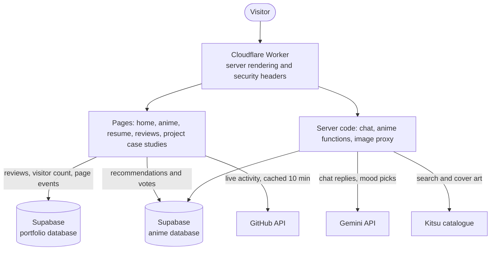

What happens when someone asks the chat a question:

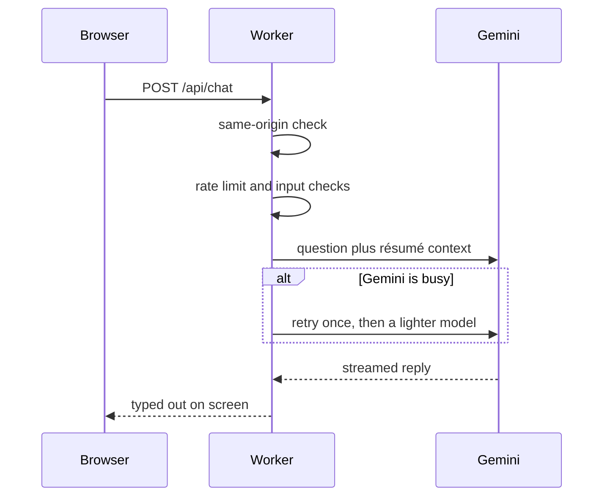

## What it runs on

| Part | What the code uses |
| --- | --- |
| App | TanStack Start with React and TypeScript |
| Styling | Tailwind CSS 4 |
| 3D | Three.js |
| Database | Supabase (Postgres with row level security) |
| Chat and mood picks | Gemini API, called from the server |
| Hosting | Cloudflare Workers, built with Bun and Vite |

## Getting started

You need [Bun](https://bun.sh).

```bash
bun install
cp .env.example .env   # then fill it in
bun run dev
```

The dev server runs at http://localhost:8080.

### Environment variables

| Variable | Used for |
| --- | --- |
| `VITE_SITE_URL` | Public site address with no trailing slash. Used for canonical and share tags. |
| `VITE_SUPABASE_URL`, `VITE_SUPABASE_PUBLISHABLE_KEY`, `VITE_SUPABASE_PROJECT_ID` | Public Supabase values, built into the page. |
| `VITE_ANIME_SUPABASE_URL`, `VITE_ANIME_SUPABASE_PUBLISHABLE_KEY` | The database that holds the anime recommendations. |
| `AI_API_KEY` | Gemini key for the chat and mood picks. **Secret, server only.** |
| `AI_MODEL`, `AI_FALLBACK_MODEL` | Optional. Default to `gemini-flash-latest` and `gemini-flash-lite-latest`. |
| `AI_BASE_URL` | Optional. Points the chat at an OpenAI-compatible provider instead of Gemini. |
| `GITHUB_TOKEN` | Optional. Raises the GitHub API rate limit. **Secret.** |

Only public values go in `.env`. Secrets such as `AI_API_KEY` are added in Cloudflare as Secrets and are never committed.

## Database

Reviews, the visitor counter and anonymous page events live in Supabase. To set up your own copy, create a project, open the SQL editor and run `supabase/setup.sql` once. The same steps are split into single files in `supabase/migrations/`.

Visitors can read and add rows. They cannot edit or delete anything. Details are in [SECURITY.md](SECURITY.md).

## Deploying

The site runs on Cloudflare Workers and rebuilds on every push to `main`.

| Setting | Value |
| --- | --- |
| Build command | `bun run build` |
| Deploy command | `npx wrangler deploy` |
| Worker name | `portfolio` (set in `vite.config.ts`, it has to match the dashboard) |

Cloudflare keeps two separate lists of variables:

- **Settings, Build, Variables and secrets** is for build-time values: `VITE_SITE_URL` and the `VITE_SUPABASE_*` ones.
- **Settings, Variables and Secrets** is for what the running site reads: `AI_API_KEY` (add it as a **Secret**), `SUPABASE_URL` and `SUPABASE_PUBLISHABLE_KEY`.

If the chat says "AI is not configured yet", the key is in the wrong list.

## Scripts

| Command | What it does |
| --- | --- |
| `bun run dev` | Starts the dev server. |
| `bun run build` | Builds the Worker and the static files. |
| `bun run lint` and `bun run format` | Checks and formats the code. |
| `node scripts/capture-projects.mjs` | Takes dark and light screenshots of the live project sites into `public/media/live/`. It works out whether a site has two themes, checks brightness so they are never swapped, and hides host badges. Add `--only <name>` for one site. |
| `node scripts/screenshots.mjs <url>` | Retakes the README images in `docs/screenshots/` from a running copy of the site. |
| `node scripts/fetch-assets.mjs` | Downloads the share image and older project screenshots from my previous site, once. |

Project screenshots are named `<project>-<number>-dark.jpg` and `<project>-<number>-light.jpg`, or `<project>-<number>.jpg` for sites with a single theme. A missing file is skipped, so nothing breaks while they are added.

## Project structure

```
.
├── src/
│   ├── routes/          Pages (home, anime, resume, reviews, case studies) and API routes
│   ├── components/
│   │   ├── portfolio/   Home page sections: hero, project ring, chat, GitHub activity
│   │   ├── anime/       The anime shelf
│   │   ├── motion/      Shared motion helpers
│   │   └── ui/          Base UI components
│   ├── lib/             Project data, server functions, abuse guards, helpers
│   ├── data/            The anime collection
│   ├── server.ts        Response wrapper and security headers
│   └── styles.css       Theme and design tokens (anime.css holds the shelf styles)
├── supabase/            Migrations and a one-file setup script
├── public/              Static files and media, including project screenshots
├── scripts/             Screenshot and media tools
├── docs/screenshots/    Images used in this README
├── SECURITY.md          What is public, what is secret, and how writes are locked down
└── vite.config.ts       Build settings and the Cloudflare Worker config
```

## Security

- Secrets live only in Cloudflare as Secrets. The built files were scanned for keys and none were found.
- Every table has row level security. Visitors can add reviews and recommendations but cannot change or delete anything.
- The chat and anime endpoints check the request origin, validate input and limit how often one visitor can call them.
- The image proxy only fetches raster images from the anime catalogue host and does not follow redirects.
- Every response carries a content security policy and the usual protective headers.

The full list, and what to do if a key leaks, is in [SECURITY.md](SECURITY.md).

## Contact

Looking for internships. Available for interviews.

[Email](mailto:abhirai2006@gmail.com) · [GitHub](https://github.com/Abhirai2006) · [LinkedIn](https://www.linkedin.com/in/abhishek-rai-a-00067238b/) · [Portfolio](https://portfolio.abhirai2006.workers.dev/)

<br>

<div align="center">

Made by Abhishek Rai A in Mysuru, India.

</div>
